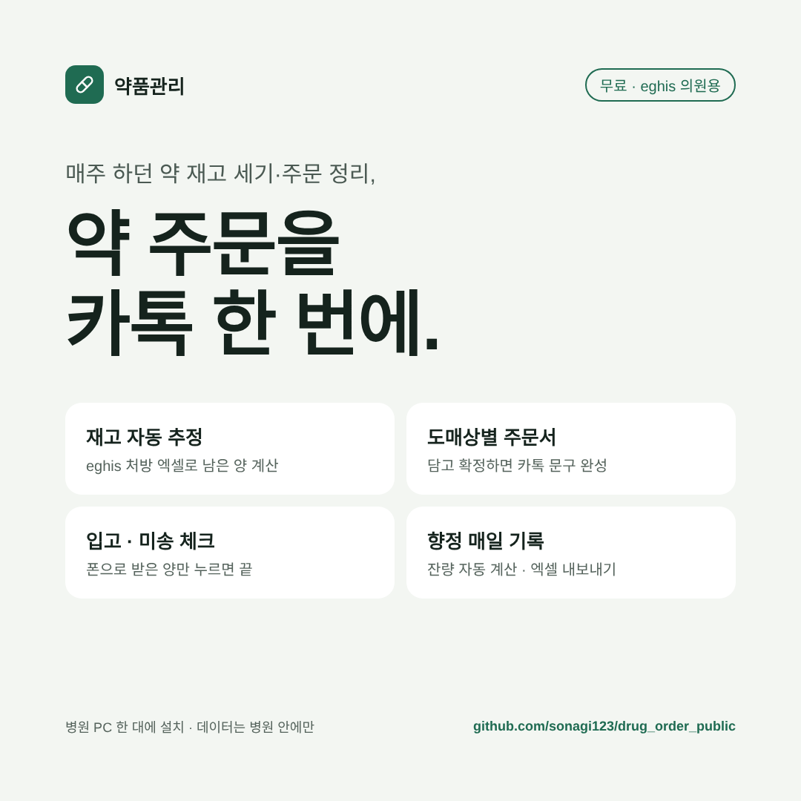
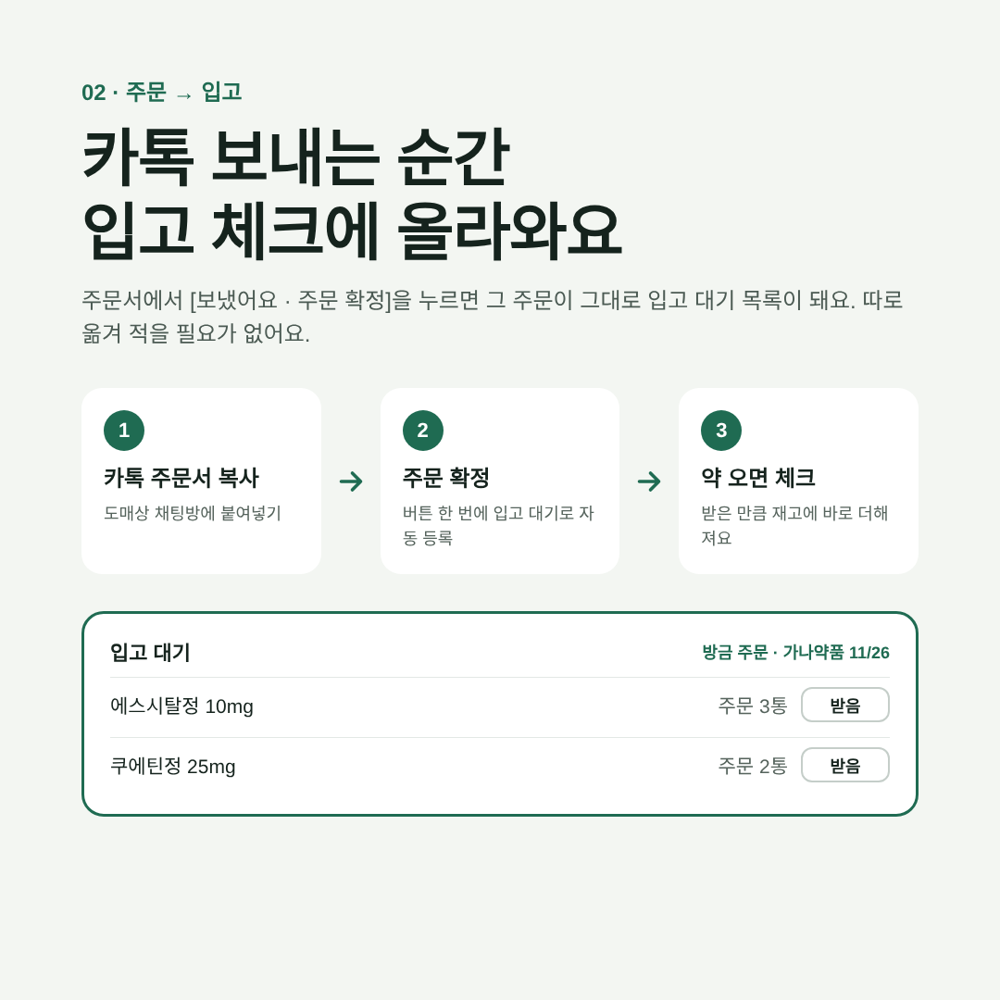
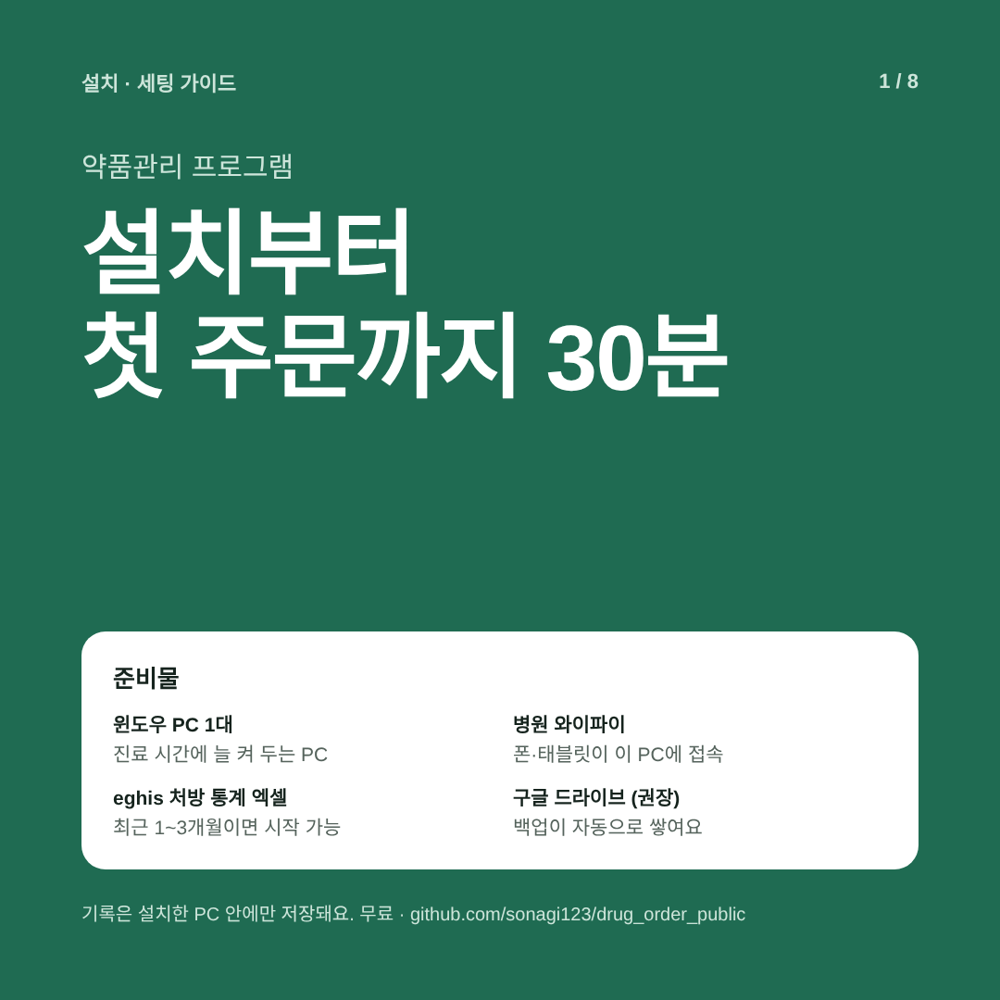

# eghis 약품 재고 · 주문 관리

eghis(이지스) EMR을 쓰는 의원을 위한 **무료 로컬 프로그램**이에요.
eghis 처방 통계로 원내 약 재고를 추정하고, 도매상별 카카오톡 주문 문구를 만들고, 입고·미송·향정 사용량·월 구매액까지 한곳에서 관리해요.

- 🚀 **처음이라면: [시작 가이드](docs/시작_가이드.md)** (설치부터 첫 주문까지 30분 · [PDF](docs/시작_가이드.pdf))
- 📄 소개 자료(화면 캡처 포함): [docs/프로그램_소개.pdf](docs/프로그램_소개.pdf)
- 🎬 사용법 영상: [docs/videos](docs/videos) (① 처음 설정 ~ ⑥ 리포트, 각 1분 내외)
- 🖼️ 카드 이미지: [앱 소개 8장](docs/cards/1_앱소개) · [설치·세팅 8장](docs/cards/2_설치세팅) (1080×1080, 카톡·SNS 공유용)
- 📦 [최신 릴리스 내려받기](https://github.com/sonagi123/drug_order_public/releases/latest)

<p>
  
</p>

## 할 수 있는 것

| 화면 | 내용 |
|---|---|
| 주문 | 약별 주평균·추정 재고·목표·제안 통 수. 약마다 도매상을 골라 담고 **[다 담았어요]** → 도매상별 **카톡 주문 문구**. 원장 확인용 스크린샷 복사. **[보냈어요 · 주문 확정]** 을 누르면 바로 입고 대기로 넘어감 |
| 입고 체크 | 태블릿·휴대폰으로 받은 수량 확인. 덜 온 양은 자동으로 **미송분**. 입고 완료 목록, 엑셀 내보내기(미송 여부 포함) |
| 향정 관리 | 매일 향정 약 사용량 입력 → 잔량 계산. 날짜별 기록 보기, 엑셀. 재고 계산을 **수기 기록 / 처방 통계** 중 원장이 선택(엑셀 방식이면 기록과 처방량 비교) |
| 약품 관리 | 포장단위·목표 재고·향정·비급여 매입가·자주 담는 도매상. 재고 입력(통 + 낱알, 반알 가능) |
| 업로드 | eghis 처방 통계·사용자등록수가·도매상 매출원장을 끌어다 놓으면 자동 인식. 지정 폴더 자동 읽기 |
| 리포트 | 월 구매액·처방액, 6개월 추이, 도매상별 결제 예정액(마감일·할인율). 원장 비밀번호 |

## 어떻게 돌아가나요

- 병원 PC **한 대**(항상 켜 두는 PC 권장)에 설치하면 그 PC가 서버가 돼요.
- 같은 병원 와이파이의 다른 PC·태블릿·휴대폰은 **설정 화면의 주소(QR)** 로 접속해요. 병원 밖에서는 접속되지 않아요.
- 모든 기록은 **그 PC 안에만** 저장돼요. 인터넷으로 보내지 않아요. eghis 통계는 약별 합계라 환자 개인정보가 없어요.
- 매일 자동 백업(구글 드라이브 데스크톱 폴더 권장, 최근 30개).
- 이 저장소에서는 **프로그램 코드만** 받아 가요. 로그인은 필요 없어요.

## 설치 (윈도우)

1. 서버로 쓸 PC에서 [최신 릴리스](https://github.com/sonagi123/drug_order_public/releases/latest)의 **Source code (zip)** (또는 이 페이지의 **[Code] → [Download ZIP]**)을 내려받아 압축을 풀고, `first_setup.bat`을 더블클릭해요. ("PC 보호" 창이 뜨면 [추가 정보] → [실행])
   Git·파이썬이 없으면 자동으로 설치하고, `C:\drug_order`에 프로그램을 받아요.
2. `C:\drug_order\autostart.bat` — 윈도우를 켜면 자동 실행되게 등록해요.
3. `C:\drug_order\firewall.bat` — **마우스 오른쪽 → 관리자 권한으로 실행** (다른 기기 접속 허용)
4. `C:\drug_order\start.bat` — 바로 실행. 바탕화면 **DrugOrder** 바로가기로 열 수 있어요.

> 파이썬 자동 설치가 안 되면 https://www.python.org 에서 Python 3.12를 설치하고(“Add python.exe to PATH” 체크) `install.bat`을 다시 실행하세요.

## 처음 설정

처음 켜면 화면 오른쪽 아래에 **시작 도우미**가 떠서 할 일을 순서대로 보여줘요(끝난 칸은 저절로 체크). 닫았다면 **도움말 → [시작 도우미 열기]**.

1. **설정** → 병원 이름, 도매상(결제 마감일·할인율), 직원 이름, 백업 폴더
2. **업로드 → 폴더 자동 읽기**에서 eghis 엑셀을 저장할 폴더를 정하고, 그 폴더에 저장해요(5분 안에 자동 반영).
    - **처방 통계**: eghis **[통계] → [진료] 처방발생 통계** → 조회 → 엑셀 (F10). 처음엔 최근 1~3개월, 그 뒤엔 주 1회. 파일 이름 끝에 기간을 붙여요(예: `처방발생 통계자료_20261122-20261128.xlsx`). 이것만 있어도 시작할 수 있어요.
    - **사용자등록수가**(있으면 좋음): eghis **[기초코드] → [기초]처방코드** → 아래 [사용자등록수가] 표의 **[약가]** 탭 → 엑셀 (F10)
    - 도매상 **매출원장**(PDF·엑셀)도 같은 폴더에 넣으면 포장단위·매입가를 읽어요.
3. **약품 관리** → 포장단위(1통 = 몇 정) 채우기 → 목표 재고 제안값 적용 → 향정 표시 → 지금 재고 입력

자세한 사용법은 프로그램의 **[도움말]** 탭에 모두 있어요.

## 업데이트

**설정 → [업데이트]** 를 누르면 이 저장소의 최신 버전을 받아 자동으로 다시 시작해요(업데이트 전 자동 백업). 병원 데이터는 그대로예요.
문제가 생기면 **설정 → 이전 버전으로 되돌리기**.

## 꼭 알아 두세요

- 재고는 처방 통계와 입고 기록으로 계산한 **추정값**이에요. 통계를 주 1회 올리고, 가끔 실제 재고를 입력하면 정확해져요.
- **향정 관리는 병원 안 재고 관리용이며, 마약류통합관리시스템(NIMS) 보고를 대신하지 않아요.**
- 매출원장은 도매상마다 양식이 달라 일부는 자동 인식이 안 될 수 있어요. 원장이 없어도 입고 기준으로 금액이 계산돼요.
- 무료로 배포되는 프로그램이에요(MIT 라이선스). 사용으로 생긴 결과에 대한 책임은 사용하는 병원에 있어요.

## 개발

```
pip install -r requirements.txt
python server.py --dev        # http://localhost:8000
```

구조·데이터 형식·계산 규칙은 [`DEVELOPMENT.md`](DEVELOPMENT.md)에 있어요. 기능을 바꾸면 `app/templates/help.html`(도움말)도 함께 고쳐 주세요.
