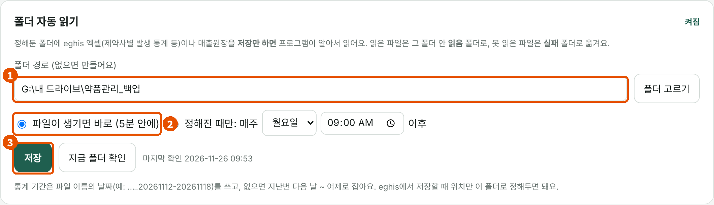
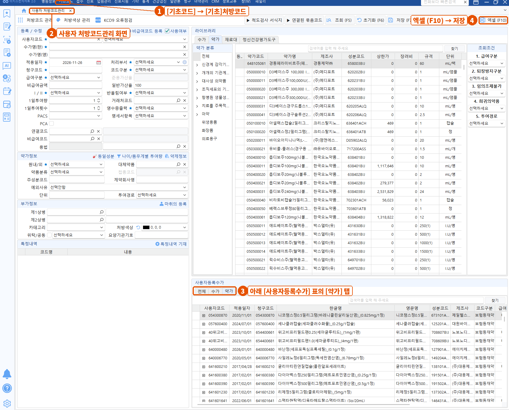
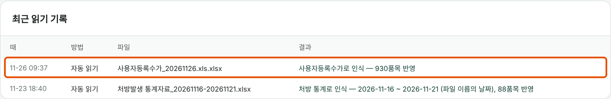

# 약품 재고·주문 관리 — 시작 가이드

eghis를 쓰는 의원에서 **원내 약 재고 추정 → 도매상별 카톡 주문 → 입고·미송 → 향정 사용량 → 월 구매액**을 관리하는 무료 프로그램이에요.
설치부터 첫 주문까지 **30분 정도** 걸려요.

---

## 0. 준비물

| 준비물 | 설명 |
|---|---|
| 윈도우 PC 1대 | 서버로 쓸 PC. **진료 시간에 항상 켜 두는 PC**(원장 PC나 접수 PC)가 좋아요 |
| 병원 와이파이 | 다른 PC·태블릿·휴대폰이 이 PC에 접속해요. 병원 밖에서는 접속되지 않아요 |
| eghis 엑셀 파일 | **처방 통계**(제약사별 발생 통계 또는 처방발생 통계) — 최근 1~3개월. 이것만 있어도 시작할 수 있어요. **사용자등록수가**(약 목록)는 있으면 좋아요 |
| (권장) 구글 드라이브 | PC용 **Google Drive 데스크톱**을 깔아 두면 백업이 구글 드라이브에 자동으로 쌓여요 |
| (선택) 도매상 매출원장 | PDF나 엑셀. 있으면 포장단위·실제 매입가를 자동으로 읽어요 |

> 모든 기록은 **설치한 PC 안에만** 저장돼요. 인터넷 서버로 보내지 않고, eghis 통계는 약별 합계라 환자 정보가 없어요.

---

## 1. 설치 (10분)

1. 서버로 쓸 PC에서 https://github.com/sonagi123/drug_order_public 에 들어가요.
2. 초록색 **[Code] → [Download ZIP]** 을 눌러 내려받고, 압축을 풀어요.
3. 압축 푼 폴더의 **`first_setup.bat`** 을 더블클릭해요.
    - "Windows의 PC 보호" 창이 뜨면 **[추가 정보] → [실행]** 을 누르세요.
    - Git·파이썬이 없으면 자동으로 설치하고, 프로그램을 `C:\drug_order` 에 받아요. 몇 분 걸려요.
4. 끝나면 `C:\drug_order` 폴더에서 다음 두 파일을 실행해요.
    - **`autostart.bat`**: 윈도우를 켜면 프로그램이 자동으로 켜지게 등록해요.
    - **`firewall.bat`**: **마우스 오른쪽 → [관리자 권한으로 실행]**. 다른 기기에서 접속할 수 있게 해요.
5. **`start.bat`** 을 실행하면 브라우저에 프로그램이 열려요. 다음부터는 바탕화면의 **DrugOrder** 를 누르면 돼요.

> 파이썬 자동 설치가 안 되면 https://www.python.org 에서 Python 3.12를 설치하고(설치 화면에서 **"Add python.exe to PATH"** 체크), `C:\drug_order\install.bat` 을 다시 실행하세요.

> 검은 창(서버)은 작업 표시줄에 그대로 두세요. 닫으면 프로그램이 꺼져요. PC를 다시 켜면 자동으로 다시 켜져요.

---

## 2. 처음 설정 (10분)

처음 켜면 화면 오른쪽 아래에 **시작 도우미**가 떠요. 할 일이 순서대로 나오고, 끝난 칸은 저절로 체크돼요. 글자를 누르면 그 화면으로 가요. (닫았다면 **도움말 → [시작 도우미 열기]**)

### ① 설정 화면
- **기본값 → 병원 이름**: 화면 제목과 카톡 인사말에 들어가요.
- **도매상**: 거래하는 도매상을 추가해요. [고치기]에서 **결제 마감일**(매월 며칠, 비우면 말일)과 **할인율**(예: 1.8%)을 넣으면 리포트에서 결제 예정액을 계산해요.
- **카톡 주문 문구**: 기본은 아래 "카톡 문구 예시"와 같아요. 도매상마다 바꿀 수도 있어요.
- **입고 체크하는 직원**: 입고 확인·향정 기록을 할 직원 이름을 넣어요.
- **구글 드라이브 백업**: [폴더 고르기]로 구글 드라이브 안의 폴더를 고르고 [폴더 저장] → [지금 백업].
- **접속 주소 (QR)**: 태블릿·휴대폰으로 QR을 찍어 들어가요. 즐겨찾기나 홈 화면에 추가해 두세요.

**카톡 문구 예시**

```
안녕하세요, {병원이름} 약품 주문 합니다.

렉사프로정10mg 3통
가모드정 2통
입니다.

좋은 하루 되세요. 감사합니다.
```

### ② 자동 읽기 폴더 정하기 (한 번만)

eghis 엑셀을 **저장할 폴더**를 하나 정해 두면, 앞으로는 그 폴더에 **저장만 해도** 프로그램이 5분 안에 알아서 읽어요.



1. **업로드 → 폴더 자동 읽기**에서 [폴더 고르기]로 폴더를 정해요. 예: `G:\내 드라이브\약품관리_엑셀`
    - 구글 드라이브 데스크톱 안의 폴더로 정하면 다른 PC에서 저장해도 이 PC로 들어와요.
2. **[파일이 생기면 바로 (5분 안에)]** 를 골라요.
3. **[저장]** 을 눌러요.

### ③ eghis에서 엑셀 받기

**사용자등록수가 (약 목록 · 약가)** — 처음 한 번, 그 뒤로는 약가가 바뀔 때(분기마다)



1. eghis 위쪽 메뉴 **[기초코드] → [기초]처방코드** 를 열어요.
2. **사용자 처방코드관리** 화면이 열려요.
3. 아래쪽 **[사용자등록수가]** 표에서 **[약가]** 탭을 눌러요.
4. 오른쪽 위 **[엑셀 (F10)]** 을 눌러 ②에서 정한 폴더에 저장해요. 파일 이름은 아무거나 괜찮아요.

**처방 통계 (처방량)** — 처음엔 최근 1~3개월, 그 뒤로는 **주 1회**

1. eghis 위쪽 메뉴 **[통계] → [진료] 처방발생 통계**를 열어요.
2. 기간을 정하고 **[조회 (F5)]** → **[엑셀 (F10)]** 으로 ②의 폴더에 저장해요.
3. **파일 이름 끝에 기간을 붙여요.** 프로그램이 이 날짜로 기간을 정해요.
    - 예: `처방발생 통계자료_20261122-20261128.xlsx`
    - 매주 기간이 **빈틈없이 이어지게** 해요(휴진하는 일요일도 포함). 예: 일~토, 다음 주 일~토
    - eghis 통계에는 날짜별 처방량이 없어서, 기간 합계를 그 기간 날짜에 고르게 나눠 계산해요. **재고를 센 다음 날부터 끊어서** 받으면 정확해요. 한 달치를 한 파일로 넣으면 재고 기준일 뒤 숫자가 어긋날 수 있어요.

> 처방 통계만 있어도 약 목록이 만들어져요. 사용자등록수가를 같이 넣으면 아직 처방하지 않은 약도 [새 약 추가]에서 찾을 수 있고, 제약사 이름이 채워져요.
> 도매상 **매출원장**(PDF·엑셀)이 있으면 같은 폴더에 넣어요. 포장단위와 실제 매입가를 읽어요.

**저장한 뒤**
- **엑셀을 닫아 주세요.** 열려 있어도 읽기는 되지만, 다 읽은 파일을 '읽음' 폴더로 옮기지 못해요.
- 5분쯤 뒤 **업로드 → 최근 읽기 기록**에 결과가 떠요. 못 읽은 파일은 '실패' 폴더로 옮겨지고 이유가 나와요.



### ④ 약품 관리 화면
- **[포장 미입력]** 필터 → 1통이 몇 정인지 채워요. 포장단위가 있어야 통 단위로 주문할 수 있어요.
- **[빈 목표에 제안값 일괄 적용]** → 최근 사용량 × 3주치 목표 재고가 들어가요. 필요한 약만 고쳐요.
- **향정** 칸을 체크해요. 체크한 약은 [향정 관리]에 나와요.
- **지금 재고**를 [재고 일괄 입력] 탭에서 넣어요. **통 + 낱알**로 적고(예: 3통 + 12.5정), **기준일**은 센 날로 해요.
  - 진료가 끝난 뒤 셌으면 그날, 아침(진료 전)에 셌으면 **전날**로 고르세요.

### ⑤ 리포트
- 처음 열 때 **원장 전용 비밀번호**를 정해요.

### ⑥ 직원 PC·폰에서 접속
- 직원 PC에는 **아무것도 설치하지 않아요.** 설정 → **접속 주소**의 주소(예: `http://192.168.0.10:8000`)를 직원 PC의 크롬·엣지 주소창에 넣어요.
- 열리면 **즐겨찾기(Ctrl+D)** 나 바탕화면 바로가기로 저장해 두세요. 폰·태블릿은 같은 화면의 **QR**을 찍어요.
- 같은 병원 인터넷(와이파이·랜)에서만 열려요. 안 열리면 서버 PC에서 `firewall.bat` 을 관리자 권한으로 다시 실행하세요.

---

## 3. 평소에 하는 일

| 언제 | 할 일 | 화면 | 누가 |
|---|---|---|---|
| **매일** 진료 후 | 향정 약마다 그날 사용량 입력 | 향정 관리 | 직원 |
| 약이 들어올 때 | 받은 수량 확인 (덜 온 건 자동으로 미송) | 입고 체크 (태블릿·휴대폰) | 직원 |
| **주 1회** | eghis 처방 통계를 자동 읽기 폴더에 저장 (기간을 이어서: 예 일~토) | 업로드 | 원장 |
| 주문하는 날 | [주문 필요] 탭 → 담기 → **[다 담았어요 · 카톡 주문서]** → 문구 복사 → 카톡 전송 → **[주문 확정]** | 주문 | 원장 |
| 가끔 | 실제 재고를 세어 입력 → 새 기준이 됨 | 약품 관리 | 직원 |
| 월말·결제일 | 구매액, 처방액, 도매상별 결제 예정액 확인 | 리포트 | 원장 |

**재고 계산 방식**
- 일반 약: 마지막으로 입력한 재고 + 그 뒤 입고 − 그 뒤 처방량(올린 eghis 통계 기준). 통계를 안 올린 날은 빼지 않아요.
- 향정 약: **설정 → 향정 재고 계산**에서 원장 비밀번호로 정해요.
    - **수기 기록으로**: 마지막으로 입력한 재고 + 그 뒤 입고 − **향정 관리에 적은 하루 사용량**. 처방 통계로는 빼지 않아서 두 번 빠지지 않아요.
    - **처방 통계 엑셀로**(새로 설치하면 기본): 일반 약처럼 처방 통계로 빼요. 향정 관리 기록은 비교용으로 남고, 엑셀 처방량과 다른 약을 주황색으로 보여줘요.

---

## 4. 업데이트와 백업

- **설정 → [업데이트]**: 최신 버전을 받아 자동으로 다시 시작해요. 업데이트 전에 자동으로 백업하고, 병원 데이터는 그대로예요.
- **설정 → [이전 버전으로 되돌리기]**: 업데이트 후 문제가 생기면 눌러요.
- **백업**은 매일 자동이에요(최근 30개). PC를 포맷했다면 1번 설치를 다시 하고 **설정 → 백업에서 복원**에서 구글 드라이브의 `.db` 파일을 고르세요.

---

## 5. 자주 묻는 질문

**다른 PC·휴대폰에서 주소가 안 열려요.**
서버 PC가 켜져 있는지, 같은 와이파이인지 확인하세요. 그래도 안 되면 서버 PC에서 `firewall.bat` 을 **관리자 권한으로** 다시 실행하세요.

**재고가 실제보다 많게 나와요.**
처방 통계를 올리기 전 날짜는 재고에서 빼지 않아요. 주문 화면 위 **"처방 반영: ○/○까지"** 를 확인하고, 그 뒤 기간의 통계를 올리세요.

**주문 수량이 안 나오는 약이 있어요.**
포장단위나 목표 재고가 비어 있으면 제안 수량이 나오지 않아요. 약품 관리에서 [포장 미입력], [목표 미입력] 필터로 채우세요.

**[스크린샷 복사]를 누르면 이미지 창이 떠요.**
서버 PC가 아닌 기기에서는 브라우저 보안 때문에 바로 복사가 막혀요. 이미지를 오른쪽 클릭 → [이미지 복사] 하거나, 그 창의 "한 번만 설정" 안내대로 크롬 설정을 바꾸면 다음부터 바로 복사돼요.

**리포트 비밀번호를 잊었어요.**
서버 PC에서 `C:\drug_order\reset_report_password.bat` 을 실행하세요. 비밀번호가 지워지고, 리포트를 다음에 열 때 새로 정해요.

**향정 기록을 NIMS 보고에 써도 되나요?**
안 돼요. 향정 관리는 **병원 안 재고 관리용**이에요. 마약류통합관리시스템(NIMS) 보고는 따로 하셔야 해요.

---

## 6. 더 보기

- 프로그램 안 **[도움말]** 탭: 화면별 자세한 사용법, 계산 방법
- 소개 자료: [프로그램_소개.pdf](프로그램_소개.pdf)
- 사용법 영상(각 1분 내외): [videos](videos)
  1. 처음 설정 · 2. 주문하기 · 3. 입고 체크와 미송 · 4. 향정 하루 사용량 · 5. 재고 입력 · 6. 리포트

> 무료로 배포되는 프로그램이에요(MIT 라이선스). 재고는 추정값이며, 사용으로 생긴 결과에 대한 책임은 사용하는 병원에 있어요.
